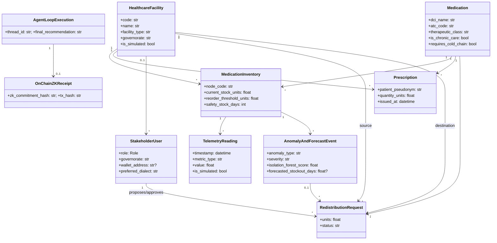
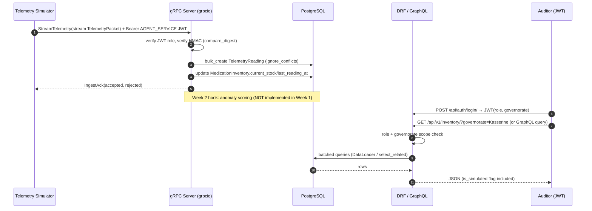

# PROJECT AUDIT — Track 5 · Tunihara-MedGuard (Group G11)

**Project:** TuniSovereign-AI — ISG Tunis DS2 Capstone 2026–2027
**Track:** Track 05 — *Predictive CNAM Subsidized Chronic-Care Medication Guard & Epidemiological Forecaster*
**Audit date:** 2026-11-17 · **Scope:** Week 1 readiness only · **Mode:** read-only audit (no source file modified, nothing installed)
**Audited copy:** local folder `tunisovereign-ds2-starter-template-main` (not a git repo). It was **not** diffed against the GitHub upstream, so any upstream update after the download is unknown.

### Status legend
| Tag | Meaning |
|---|---|
| ✅ **VERIFIED** | Correctness confirmed by reading the source; behaviour is self-evident or checked against another file. |
| 🟡 **PRESENT / NOT VERIFIED** | Code exists and looks plausible, but was not executed (audit mode forbids installs), or depends on unverified external behaviour. |
| 🟠 **INCOMPLETE** | A stub, partial, or internally inconsistent implementation. |
| ❌ **MISSING** | Required by the README / Week 1 brief, but absent from the repo. |

> **Method note.** Nothing was executed except `python --version`, `py -0p`, `docker --version`. "Verified" therefore means *verified by static reading*, not by running. Where a defect is a deterministic consequence of the source (e.g. a wrong keyword argument), it is stated as a fact with the line reference.

---

## 0. Executive summary

The starter template is **a reference skeleton, not a runnable Django project**. It contains 7 ORM model definitions, one DRF module, one Strawberry stub, one gRPC servicer class, a one-function simulator, and Week 2–4 demos. It has **no `manage.py`, no settings, no URLconf, no migrations, no generated gRPC stubs, no PostgreSQL driver, no tests, and no `__init__.py` files**. Several advertised behaviours are simulated or broken:

1. **The agent loop crashes** (`agent/langgraph_agent.py:52-57` calls the MCP tool with kwargs that do not exist, and reads dict keys the tool never returns). Anything that calls it (DRF webhook, gRPC server, dashboard, README "sample output") is broken.
2. **"LangGraph" is not used anywhere** — the "stateful loop" is a plain sequential function.
3. **Blockchain "anchoring" is fabricated** — `tx_hash` is a SHA-256 of strings; no transaction is ever sent.
4. **GraphQL returns a hard-coded water-co-op sample**; the `DataLoader` is imported but never used.
5. **gRPC server cannot start serving the proto** (servicer never registered, stubs never generated, returns dicts).
6. **Dockerfile uses Python 3.11 but `django>=6.0` requires Python ≥ 3.12** → `docker compose build` of the dashboard image will fail at `pip install`.
7. The README's "7 core models" are entirely **water/agri-oriented** and must be re-expressed for Track 5.

Good news: the architecture split (core / protos / grpc / simulator / agent / mcp / contracts / dashboard / workflows) is clean and maps 1:1 to the Week 1–4 plan, the local machine has Python 3.12 + Docker, and nothing in Week 1 requires rewriting the layout — only **adding** the Django project scaffolding and **adapting** the domain.

---

## A. Existing project architecture

Six-layer service-oriented design (README §"System Architecture Overview"), actual realisation:

| Layer (README) | Intended | Actual state in repo |
|---|---|---|
| L1 Django 6 core + JWT RBAC + REST + GraphQL + gRPC | Multi-protocol gateway | Fragments only: `models.py`, `api_rest.py`, `schema_graphql.py` (stub), `grpc_service/server.py` (non-functional) — no project wiring |
| L2 ML anomaly + forecast | IsolationForest + rolling Z-score + P/R/F1 | `ml_anomaly.py`: IsolationForest + P/R/F1 on **synthetic water data**; **no Z-score, no forecast** |
| L3/L4 LangGraph agent + FastMCP + 3 skills | Cyclic graph, MCP server | Sequential function; MCP shim; rule-based skills; **broken call** (see C/D) |
| L5 ZK + Solidity | On-chain commitment | `.sol` contract exists (uncompiled, untested); Python client **never sends a tx** |
| L6 Streamlit + n8n | Dashboard + automation | Single-page Streamlit demo; n8n JSON with **empty `connections`** |

Infrastructure (`docker-compose.yml`): `db` (Postgres 16), `redis` (7), `anvil-blockchain`, `dashboard` (Streamlit), `n8n-boundary`. **There is no Django/ASGI, gRPC, or simulator service.**

Data flow intended for Week 1: `Simulator → gRPC (proto3) → Django → PostgreSQL ← DRF / GraphQL ← clients`. Of these edges, **none is implemented end-to-end** today.

---

## B. Existing files and their actual responsibilities

| Path | Lines | Actual responsibility | Status |
|---|---|---|---|
| `README.md` | 208 | Course brief, architecture, roadmap, rubric, 8 tracks | ✅ (documentation); sample outputs 🟡 unreproducible — see D/N |
| `requirements.txt` | 24 | Unpinned lower bounds (`>=`) for all deps | 🟠 no DB driver, no test tools, no upper bounds |
| `Dockerfile` | 7 | `python:3.11-slim`, installs reqs, runs **Streamlit only** | 🟠 wrong Python for Django 6; no Django/gRPC entrypoints |
| `docker-compose.yml` | 44 | db, redis, anvil, dashboard, n8n | 🟠 see D; `version: '3.9'` obsolete key |
| `.env.example` | 18 | Env template | 🟠 real-looking defaults; used *as* the runtime env file |
| `.gitignore` | 30 | Standard ignores (`.env`, `__pycache__`…) | ✅ |
| `LICENSE` | — | MIT | ✅ |
| `backend/tunisovereign_core/models.py` | 88 | `StakeholderUser` + 6 models (water/agri semantics) | 🟡 syntactically plausible, no app/migration |
| `backend/tunisovereign_core/api_rest.py` | 165 | JWT serializer/view, 3 permission classes, 5 serializers, 4 ViewSets, 1 webhook | 🟠 see C/D/N |
| `backend/tunisovereign_core/schema_graphql.py` | 69 | Strawberry types + `Query.governorate_cooperatives` returning **hard-coded data** | 🟠 stub |
| `backend/tunisovereign_core/ml_anomaly.py` | 55 | `TunisianTelemetryAnomalyEngine`: IsolationForest on 3 synthetic water metrics, P/R/F1 | 🟡 Week 2 asset; water-specific |
| `protos/tunisovereign.proto` | 32 | `TelemetryIngestService`: `StreamTelemetry`(client-stream), `TriggerUrgentAudit` | ✅ valid proto3 syntax by reading; 🟡 not compiled |
| `grpc_service/server.py` | 86 | Servicer class; `serve()` | 🟠 does not register servicer; see J/N |
| `simulator/tunisian_simulator.py` | 58 | Generates 24 h × 5 nodes of MOISTURE packets, HMAC-signs them, prints counts | 🟠 generator only; sends nothing |
| `mcp_server/tunisovereign_mcp.py` | 81 | FastMCP (+ no-op shim), 1 resource, 1 tool, 1 prompt | 🟡 Week 2; **signature mismatch with caller** |
| `agent/langgraph_agent.py` | 100 | `run_sovereign_agent_loop` sequential pipeline | ❌ broken (see D-1); no LangGraph |
| `agent/skills/tunisovereign_skills.py` | 70 | 3 dataclass "skills" (Darja parser, threshold anomaly, SHA-256 "ZK") | 🟠 heuristic placeholders |
| `contracts/TuniSovereignLedger.sol` | 48 | `anchorZKSettlement` with quota require | 🟡 Week 3; uncompiled |
| `contracts/web3_zk_client.py` | 59 | Salted SHA-256 commitment; connects to RPC but sends no tx | 🟠 fabricates `tx_hash` |
| `dashboard/streamlit_command_center.py` | 60 | Static metrics + agent form + ML benchmark table | 🟠 Week 4 demo; fake "8 Hubs" metric |
| `workflows/tunisovereign_n8n_boundary_workflow.json` | 86 | 6 n8n nodes, `"connections": {}` | 🟠 nodes unconnected |

**Not present at all:** `manage.py`, `config/settings.py`, `urls.py`, `asgi.py`/`wsgi.py`, `apps.py`, any `__init__.py`, `migrations/`, `tests/`, generated `*_pb2*.py`, `docs/` (created by this audit), UML diagrams.

---

## C. Existing working components

Strictly limited to what is sound by reading; **none were executed**.

| Component | File | Evidence | Status |
|---|---|---|---|
| Four role identifiers exactly as required | `models.py:7-11` | `COOP_MEMBER, REGIONAL_AUDITOR, NATIONAL_ADMIN, AGENT_SERVICE` | ✅ |
| Custom user via `AbstractUser` + role/governorate/wallet/dialect | `models.py:6-16` | Field definitions are valid Django | ✅ (needs `AUTH_USER_MODEL`, absent) |
| Custom JWT claims (`role`, `governorate`, `wallet_address`, `preferred_dialect`) | `api_rest.py:29-41` | Correct SimpleJWT `get_token` override pattern | 🟡 |
| Role permission class shapes | `api_rest.py:47-67` | Standard `BasePermission` | 🟠 semantics too coarse (see G) |
| Telemetry index `(node, metric_type, -timestamp)` | `models.py:51-52` | Good fit for latest-reading and range queries | ✅ |
| `select_related` on ViewSet querysets | `api_rest.py:121,127,133` | Avoids N+1 in REST list views | ✅ |
| Proto3 contract (client-streaming ingest + unary audit) | `protos/tunisovereign.proto` | Valid syntax; matches README | ✅ |
| HMAC-SHA256 packet signing concept | `simulator:36-37` | `hmac.new(key, payload, sha256)` | 🟡 (signature never verified server-side) |
| IsolationForest + P/R/F1 harness | `ml_anomaly.py:18-49` | Standard sklearn usage | 🟡 Week 2 |
| Solidity quota guard + duplicate-commitment guard | `TuniSovereignLedger.sol:33-34` | `require` statements are correct | 🟡 Week 3 |
| Repo layout / separation of concerns | whole tree | Matches README structure and four-week plan | ✅ |
| Local toolchain | environment | Python **3.12.10** (+3.14), Docker 29.3.1 present | ✅ |

---

## D. Missing or incomplete components

### D-1 · **CRITICAL — agent loop is broken (deterministic crash)**
Evidence:
- `agent/langgraph_agent.py:52-57` calls `calculate_sovereign_quota_allocation(governorate=…, soil_moisture_pct=…, temp_c=…, requested_units=…)`.
- `mcp_server/tunisovereign_mcp.py:45-50` defines `(governorate, current_metric_value, ambient_temp_c, requested_units)` → **`TypeError: unexpected keyword argument 'soil_moisture_pct'`**.
- Even if fixed, `langgraph_agent.py:66-67,77` read `mcp_res["approved_units"]` / `["max_daily_quota"]`; the tool returns `recommended_units` (no `approved_units`) → **`KeyError`**.
- Consequence: `darja_intent_webhook`, gRPC `TriggerUrgentAudit` / `StreamTelemetry` (when moisture < 35), the dashboard form, and the README "Sample Output" **cannot work as shipped**. Status: ❌.
- Scope: Agent is Week 3; but because Week 1 REST + gRPC import and call it, Week 1 must **decouple** from it (see roadmap), not "fix the agent".

### D-2 · **CRITICAL — no Django project exists**
No `manage.py` / settings / URLs / ASGI / `apps.py` / migrations / `__init__.py`. `backend/tunisovereign_core/models.py` cannot be loaded by Django. `AUTH_USER_MODEL` is unset, so `AbstractUser` subclass would clash with `auth.User`. ❌ Missing.

### D-3 · **CRITICAL — wrong Python in Docker**
`Dockerfile:1` `python:3.11-slim` + `requirements.txt:1` `django>=6.0`. Django 6.0 supports Python 3.12+ only (and README line 8 states "Python 3.11+"). `pip install` will fail to resolve Django 6 on 3.11. Local dev (3.12.10) is fine. Status: ❌ for Docker; ✅ for local. *Version support statement is from my knowledge of Django 6.0's release notes — **verify against the Django 6.0 docs** before changing the image.*

### D-4 · No PostgreSQL driver
`requirements.txt` has no `psycopg`/`psycopg2`. Django cannot talk to the `db` service. ❌

### D-5 · `docker-compose.yml` gaps
- No Django (ASGI/Daphne) service, no gRPC service, no simulator service, no migration step. (`docker-compose.yml:3-44`) ❌
- `db` has no volume (data lost on `down`), no healthcheck; `depends_on` has no `condition: service_healthy`. 🟠
- `dashboard.env_file: .env.example` (`:27-28`) loads the committed template instead of a private `.env`. 🟠
- `ghcr.io/foundry-rs/foundry:latest`, `n8n:latest` unpinned. 🟠
- `POSTGRES_HOST=localhost` in `.env.example:7` is wrong *inside* containers (must be `db`). Same for `REDIS_URL`, `WEB3_RPC_URL`, and n8n target `http://localhost:8000` (workflow). 🟠

### D-6 · gRPC service not functional
`grpc_service/server.py`: stubs never generated (README step 2 produces `tunisovereign_pb2*.py` into `grpc_service/`, none present); the servicer is a plain class that does **not subclass** the generated `TelemetryIngestServiceServicer`; `serve()` never calls `add_TelemetryIngestServiceServicer_to_server` (`:73-82`) → server starts but answers `UNIMPLEMENTED` for every RPC. Handlers return `dict`s, not `IngestAck`/`AuditResponse` messages (`:45-49, 67-70`). No DB write at all — Week 1 requires "PostgreSQL telemetry persistence". ❌

### D-7 · GraphQL is a stub; DataLoader unused
`schema_graphql.py:34-36` `batch_load_executions` returns empty lists and is **never instantiated**; `Query` returns fabricated Kasserine water data (`:42-66`). No ORM access, no auth context, no `strawberry-graphql-django` wiring, no `/graphql/` URL. ❌ (N+1 prevention is a graded Week 1 item.)

### D-8 · DRF layer incomplete
- Docstring promises `POST /api/auth/register/`, `/api/auth/login/` (`api_rest.py:3`): **no register view**, `SovereignTokenObtainPairView` is defined but **no URL** is wired; no refresh/verify routes. ❌
- No router/URLconf; `ResourceNodePlot` has a serializer but **no ViewSet**; `AgentLoopExecution` has a serializer but **no ViewSet**. ❌
- `from agent.langgraph_agent import …` at module top (`:23`) makes the entire REST module fail to import unless repo root is on `sys.path` **and** the agent module imports cleanly (it imports `mcp_server…`). 🟠 (coupling)
- n8n workflow targets `/api/v1/external-context/` (`workflow.json:42`) — **endpoint does not exist**. ❌

### D-9 · Simulator is a generator, not a stream
`simulator/tunisian_simulator.py`: returns a list and prints counts; never opens a gRPC channel, never writes to DB (docstring line 4 "triggers the pipeline" is untrue). Only `MOISTURE` metric; packet dict uses `moisture_pct` (`:44`) while the proto field is `value` — shape mismatch. `iso_ts = datetime.now()` for every packet (`:35`) so all 120 packets carry near-identical wall-clock times regardless of simulated `hour`. `random.Random(42)` hard-coded (no seed parameter). HMAC secret defaulted in code (`:22`). ❌/🟠

### D-10 · Other
| Item | Evidence | Status |
|---|---|---|
| UML Class + Sequence diagrams | none in repo | ❌ |
| Tests | none | ❌ |
| Migrations | none | ❌ |
| Rolling Z-score / forecasting | `ml_anomaly.py` docstring promises, code has none | ❌ (Week 2) |
| LangGraph `StateGraph` | `langgraph` in requirements, never imported | ❌ (Week 3) |
| n8n connections | `"connections": {}` (`workflow.json:86`); trigger named "Daily_06h00" but `hoursInterval: 6` | 🟠 (Week 4) |
| Real chain transaction | `web3_zk_client.py:36` fabricates `tx_hash`; `ZKContractSettlementSkill` hard-codes `block_number: 1024` | ❌ (Week 3) |
| Foundry build/deploy | no `foundry.toml`, no deploy script | ❌ (Week 3) |
| WebSockets/SSE | `channels`, `daphne`, `channels-redis` listed, unused | ❌ (Week 4) |

---

## E. Track 1 assumptions that must be adapted to Track 5

| # | Track 1 (water/agri) assumption | Evidence (file:line) | Track 5 adaptation |
|---|---|---|---|
| 1 | `COOP_MEMBER` = "Farmer / Citizen / Field Operator" | `models.py:8` | Pharmacist / facility stock operator (technical id unchanged) |
| 2 | `CooperativeUnit` (GDA water co-op) with `daily_quota_limit` | `models.py:19-26` | `HealthcareFacility` (hospital pharmacy, PCT regional depot, community pharmacy…) |
| 3 | `track_domain` default `"Track_01_Water_Agri"` | `models.py:23`, `schema_graphql.py:62` | `"Track_05_Tunihara_MedGuard"` |
| 4 | `ResourceNodePlot` (crop plot, valve) | `models.py:29-35` | `MedicationInventory` (facility × medication stock position); `is_valve_or_dispatch_active` → redistribution hold flag |
| 5 | Telemetry metrics `MOISTURE/FLOW/TEMP/STOCK` | `models.py:39-43` | `STOCK_LEVEL, DISPENSED_UNITS, CONSUMPTION_RATE, COLD_CHAIN_TEMP, RX_COUNT` |
| 6 | Anomaly types leak/diversion/Sirocco | `models.py:59`, `ml_anomaly.py:27` | abnormal consumption, duplicate prescription, stock-out risk |
| 7 | `forecasted_deficit_24h` | `models.py:66` | stock-out horizon in **days** (chronic medication horizons are 7–30 d, not 24 h) |
| 8 | Soil moisture drives alerts (`<35%`) | `grpc_service/server.py:28`, `skills:36`, simulator | days-of-cover below safety threshold / consumption z-score |
| 9 | Governorate quota table (litres) | `mcp_server:25-32` | per-medication, per-governorate coverage policy (Week 2) |
| 10 | Darja parser keyed to water words | `skills:13` | pharmacy/stock vocabulary (Week 2/3 — **not now**) |
| 11 | `flow_l_min`, `moisture_pct` agent state | `langgraph_agent.py:18-20` | Week 3 state redesign; **do not touch in Week 1** |
| 12 | Governorate set: Kasserine, Sidi Bouzid, Gafsa, Kairouan, Tozeur, Sfax, Béja | README:20, simulator | Keep but add **Tunis, Ariana, Sousse, Médenine** etc. (see K); stop using inconsistent spellings (`Sidi_Bouzid` vs `Sidi Bouzid`) → one canonical code list |
| 13 | n8n Open-Meteo evapotranspiration (ET0) | `workflow.json:30` | Epidemiological context (seasonal/heat/flu-season signal); ET0 irrelevant — Week 4 |
| 14 | Ledger `allocatedUnits ≤ maxQuotaUnits` | `.sol:33` | Redistribution ≤ donor surplus (Week 3) |
| 15 | Dashboard copy "8 Hubs", farmer text | `dashboard:17,25` | Week 4 |

**Overlap warning:** Track 02 *PharmaSovereign-TN* (README:164) also covers drugs/cold-chain/anti-shortage. Track 5 must stay focused on **CNAM-subsidised chronic-care demand forecasting and stock-out prediction**; cold-chain telemetry should stay a secondary signal (insulin only) to avoid drifting into Track 02.

---

## F. Proposed Track 5 domain model and database relationships

### F.1 Honest data-provenance rules (apply to every table)
- Every ingested/generated row carries **`is_simulated` (bool, default True)** and a `data_source` label (`SIMULATOR`, `MANUAL_ENTRY`, and later `VERIFIED_IMPORT`). Nothing in the repo is real CNAM/PCT data. The UI/API must display this flag.
- **No real CNAM/hospital APIs, no real patient data.** Patients exist only as an irreversible **pseudonym hash** produced in the simulator; no names, CIN, or CNAM numbers. Medication catalogue entries (generic names/ATC codes) are public-domain pharmacological facts; *subsidy status and prices must be flagged "illustrative" unless sourced from an official list the team cites.*

### F.2 Mapping the 12 proposed concepts onto the 7 starter models (no duplicates)

| Proposed concept | Decision | Maps to starter model | Rationale |
|---|---|---|---|
| StakeholderUser | **Keep, extend** | `StakeholderUser` | add nullable `facility` FK (scope for COOP_MEMBER) |
| HealthcareFacility | **Adapt (rename)** | `CooperativeUnit` | same shape (name, governorate, capacity). Nothing is migrated yet, so a rename is free |
| Medication | **New (necessary)** | — | no starter equivalent; catalogue needed by every other table |
| MedicationInventory | **Adapt (rename)** | `ResourceNodePlot` | the "node" in starter = a monitored unit; here = facility×medication stock position; keeps `node_code` as gRPC key |
| TelemetryReading | **Adapt** | `TelemetryReading` | same table; new `MetricType`, `is_simulated`, FK → `MedicationInventory` |
| MedicationConsumption | **Do NOT create in Week 1** | derive from `TelemetryReading(DISPENSED_UNITS)` aggregates | would duplicate telemetry; add a rollup/materialised view in Week 2 if forecasting needs it |
| Prescription | **New (minimal)** | — | required for duplicate-prescription detection; pseudonymised |
| PatientEligibilityRecord | **Defer / fold in** | fields `patient_pseudonym`, `cnam_coverage_category` on `Prescription` | avoids a PII-adjacent table in Week 1; **decision for team** |
| AnomalyAndForecastEvent | **Adapt** | `AnomalyAndForecastEvent` | FK → `MedicationInventory`; add duplicate-Rx FK (nullable) |
| RedistributionRequest | **New (necessary)** | — | the Track's key output (source → destination facility, units, status) |
| AgentLoopExecution | **Keep as-is (schema only)** | `AgentLoopExecution` | Week 3 populates it; `darja_transcript` may become generic `trigger_payload` later |
| OnChainZKReceipt | **Keep as-is (schema only)** | `OnChainZKReceipt` | Week 3; `is_verified_on_chain` default `True` (`models.py:88`) is **unsafe** → default `False` |

Result: **10 models** (7 adapted/kept + `Medication`, `Prescription`, `RedistributionRequest`). If the team prefers to honour the README's "7 core models" literally, the minimum viable alternative is to fold `Medication` into `MedicationInventory` — **not recommended** (denormalises the catalogue).

### F.3 Proposed fields (Week 1)

```
StakeholderUser(AbstractUser)
  role: COOP_MEMBER|REGIONAL_AUDITOR|NATIONAL_ADMIN|AGENT_SERVICE
  governorate: CharField(choices=GOVERNORATES, db_index)   # canonical codes, no free text
  facility: FK(HealthcareFacility, null, SET_NULL)         # scope for COOP_MEMBER
  wallet_address, preferred_dialect                        # kept (used Week 3)

HealthcareFacility           (was CooperativeUnit)
  id UUID, code (unique), name, facility_type[HOSPITAL|PCT_DEPOT|PHARMACY|CLINIC]
  governorate (indexed), latitude/longitude (null, for Week 4 map)
  is_simulated, created_at

Medication
  id, dci_name (INN), atc_code, therapeutic_class[DIABETES|HYPERTENSION|CARDIAC|ASTHMA|…]
  dosage_form, strength, unit_of_measure
  is_chronic_care (bool), cnam_subsidy_status[ILLUSTRATIVE_SUBSIDISED|ILLUSTRATIVE_NOT_SUBSIDISED|UNKNOWN]
  requires_cold_chain (bool, e.g. insulin)

MedicationInventory          (was ResourceNodePlot)
  facility FK, medication FK, UNIQUE(facility, medication)
  node_code UNIQUE            # e.g. "KAS-HOP-REG-METFORMIN"; gRPC/simulator key
  current_stock_units, reorder_threshold_units, safety_stock_days
  last_reading_at, is_redistribution_hold

TelemetryReading
  inventory FK(MedicationInventory), timestamp(indexed), metric_type, value
  ingestion_protocol, is_simulated, signature_valid(bool)
  UNIQUE(inventory, metric_type, timestamp)   # idempotent ingestion
  index(inventory, metric_type, -timestamp)   # kept

Prescription
  id UUID, facility FK, medication FK, issued_at
  patient_pseudonym (char64, HMAC hash, indexed)   # NEVER a real identifier
  quantity_units, cnam_coverage_category, is_simulated
  index(patient_pseudonym, medication, issued_at)  # duplicate-Rx lookup

AnomalyAndForecastEvent
  inventory FK, detected_at, anomaly_type[ABNORMAL_CONSUMPTION|DUPLICATE_PRESCRIPTION|STOCKOUT_RISK|COLD_CHAIN]
  severity[LOW|MEDIUM|CRITICAL], isolation_forest_score,
  forecasted_stockout_days (null), related_prescription FK (null)

RedistributionRequest
  source_facility FK, destination_facility FK, medication FK, units
  status[PROPOSED|APPROVED|REJECTED|EXECUTED], proposed_by FK(User), approved_by FK(User,null)
  rationale(JSON), related_event FK(AnomalyAndForecastEvent,null), created_at

AgentLoopExecution / OnChainZKReceipt  — unchanged (Week 3)
```

### F.4 Relationships
```
HealthcareFacility 1—* MedicationInventory *—1 Medication
MedicationInventory 1—* TelemetryReading
MedicationInventory 1—* AnomalyAndForecastEvent
HealthcareFacility 1—* Prescription *—1 Medication
HealthcareFacility 1—* StakeholderUser (nullable)
RedistributionRequest *—1 source Facility, *—1 destination Facility, *—1 Medication
AnomalyAndForecastEvent 1—* RedistributionRequest (optional)
AgentLoopExecution 1—1 OnChainZKReceipt
```

---

## G. Proposed four-role healthcare authorization matrix

Technical identifiers are preserved exactly. Interpretations are **proposals** (the README gives only generic labels — see Ambiguity AMB-3).

| Role id | Healthcare meaning | Scope |
|---|---|---|
| `COOP_MEMBER` | Pharmacist / stock operator at one facility | own facility only |
| `REGIONAL_AUDITOR` | Regional health directorate / PCT regional supervisor | own governorate, read-heavy |
| `NATIONAL_ADMIN` | Ministry of Health / CNAM-level administrator | all governorates |
| `AGENT_SERVICE` | Autonomous agent / simulator / MCP service account | machine, write telemetry & events |

| Resource | COOP_MEMBER | REGIONAL_AUDITOR | NATIONAL_ADMIN | AGENT_SERVICE |
|---|---|---|---|---|
| Facilities | R own | R own governorate | CRUD all | R |
| Medications (catalogue) | R | R | CRUD | R |
| Inventory | R/U own facility | R governorate | CRUD all | R/U |
| Telemetry | R own; (C via UI optional) | R governorate | R all | **C** (ingest), R |
| Prescriptions | C/R own facility (pseudonymised) | R governorate | R all | R |
| Anomaly/Forecast events | R own | R governorate | R all | **C**, R |
| Redistribution requests | C (request) / R own | R, approve within governorate | CRUD, final approve | C (propose) |
| Agent executions / ZK receipts | — | R governorate | R all | **C** |
| User management / register | self-register as COOP_MEMBER only | — | assign any role | — |

**Defects in the current permission classes (`api_rest.py:47-67`):**
1. `IsCoopMember` only checks authentication — any role passes; there is no role check. (`:47-49`)
2. `IsRegionalAuditor` grants `AGENT_SERVICE` the same rights as auditors (`:57`), and neither class enforces **governorate/facility scoping** — a Kasserine auditor can read Tunis data.
3. All ViewSets are `ModelViewSet` (full CRUD) for any authenticated user (`:114-129`) → a COOP_MEMBER can POST/DELETE cooperatives and telemetry. Must be method-level (`SAFE_METHODS` vs write roles).
4. Registration must **never accept `role` from the client**.

---

## H. Required REST endpoints (Week 1)

Base: `/api/v1/` · JWT bearer · pagination + filtering · OpenAPI optional.

| Method & path | Roles | Notes |
|---|---|---|
| `POST /api/auth/register/` | public | creates **COOP_MEMBER** only; ignores any `role` input |
| `POST /api/auth/login/` | public | `SovereignTokenObtainPairView` (claims: role, governorate, wallet_address, facility) — existing |
| `POST /api/auth/refresh/` | public | SimpleJWT refresh |
| `GET /api/auth/me/` | any | current identity |
| `GET/POST/PATCH /api/v1/facilities/` | per matrix | scoped queryset |
| `GET/POST/PATCH /api/v1/medications/` | read all, write ADMIN | |
| `GET/PATCH /api/v1/inventory/` | per matrix | `?facility=&medication=&governorate=` |
| `GET/POST /api/v1/telemetry/` | per matrix | `POST` bulk (list) for AGENT_SERVICE; `?inventory=&metric_type=&from=&to=` |
| `GET/POST /api/v1/prescriptions/` | per matrix | pseudonymised |
| `GET/POST /api/v1/anomalies/` | per matrix | exists as `/anomalies/` |
| `GET/POST/PATCH /api/v1/redistribution-requests/` | per matrix | status transitions guarded |
| `GET /api/v1/zk-receipts/`, `/agent-executions/` | read-only | exists as ViewSet (zk), agent-exec missing; **populated Week 3** |
| `GET /api/v1/health/` | public | liveness for compose |
| `POST /api/v1/darja-intent/` | — | **Do not expose in Week 1** (calls broken agent; currently `AllowAny`) |
| `POST /api/v1/external-context/` | AGENT_SERVICE | referenced by n8n; **Week 4** |

Removed/renamed: `/cooperatives/` → `/facilities/` (only if the rename is accepted).

---

## I. Required GraphQL types and queries

Endpoint `/graphql/` (Strawberry, JWT-authenticated context carrying `request.user`).

**Types:** `GovernorateType`, `FacilityType`, `MedicationType`, `InventoryType`, `TelemetryReadingType`, `AnomalyEventType`, `RedistributionRequestType` (+ `AgentExecutionType`/`ZKReceiptType` retained, empty until Week 3).

**Queries:**
```graphql
facilities(governorate: String): [FacilityType!]!          # each with inventory{ medication, latestStock }
inventory(facilityId: ID, medicationId: ID, governorate: String): [InventoryType!]!
telemetry(inventoryId: ID!, metric: MetricType, from: DateTime, to: DateTime, limit: Int): [TelemetryReadingType!]!
anomalies(governorate: String, severity: Severity): [AnomalyEventType!]!
redistributionRequests(status: Status): [RedistributionRequestType!]!
shortageRiskByGovernorate: [GovernorateRiskType!]!         # aggregate only; no forecast logic in Week 1
```

**DataLoader requirement (graded):** per-request loaders (`inventory_by_facility`, `medication_by_id`, `latest_telemetry_by_inventory`, `anomalies_by_inventory`) using `strawberry.dataloader.DataLoader` with batched `filter(id__in=keys)`; loaders created in context per request. **Prove it** with a test using `django.test.utils.CaptureQueriesContext` asserting a constant query count for N facilities.

---

## J. Required gRPC messages and service methods

Proto stays contract-first; extend, do not replace. Proposed `protos/tunisovereign.proto` v2 (package/service names preserved for compatibility):

```proto
message TelemetryPacket {
  string node_code = 1;        // MedicationInventory.node_code
  string governorate = 2;
  string metric_type = 3;      // → enum in v2
  double value = 4;
  string iso_timestamp = 5;
  string signature_hmac = 6;
  string unit = 7;             // new: "boxes", "C"
  bool   is_simulated = 8;     // new: provenance
}
// IngestAck: add rejected_count, rejected_reasons[]  (keep fields 1-3 numbering)
// StreamTelemetry (client-stream) → keep
// TriggerUrgentAudit → keep signature; Week 1 returns a stubbed status, NO agent call
// New unary: GetInventoryStatus(InventoryRequest) → InventoryStatus   (optional, useful for demo)
```
Server requirements: subclass generated servicer; register via `add_…_to_server`; verify HMAC (constant-time `hmac.compare_digest`); validate `node_code`/metric; `bulk_create(ignore_conflicts=True)` in batches; return real `IngestAck`; **auth** via metadata (`authorization: Bearer <AGENT_SERVICE JWT>`) interceptor; ORM access from a sync thread pool needs `django.setup()` and connection cleanup (`close_old_connections`); no agent call in the ingest path in Week 1.

Compile command per README `-I./protos --python_out=./grpc_service` generates `import tunisovereign_pb2` — the **generated grpc file uses a top-level import** that breaks when `grpc_service` is a package. Plan: generate into a package and fix the import (known `grpc_tools` quirk) or use `protoletariat`-style patch. *(Not verified; flag for implementation.)*

---

## K. Track 5 telemetry simulator design

Goal: realistic, **clearly synthetic**, deterministic-by-seed, usable as the Week 2 ground truth.

- **Entities:** ~8–10 facilities across governorates (Tunis, Ariana, Sfax, Sousse, Kairouan, Kasserine, Sidi Bouzid, Gafsa, Médenine, Tozeur) of types HOSPITAL / PCT_DEPOT / PHARMACY; ~6 chronic-care medications (e.g. metformin, insulin glargine, amlodipine, enalapril, salbutamol, levothyroxine — generic public names; counts **illustrative**).
- **Streams per `(facility, medication)` node** every simulated hour: `STOCK_LEVEL`, `DISPENSED_UNITS`, `CONSUMPTION_RATE`, `RX_COUNT`; plus `COLD_CHAIN_TEMP` for insulin only.
- **Model:** `consumption = base × weekly_pattern(pharmacy opening days) × seasonal(flu/heat) × epidemic_factor + noise`; stock follows `stock(t+1) = stock(t) − dispensed + deliveries` with periodic replenishment; a **supply delay** scenario produces genuine stock-out trajectories.
- **Injected labelled anomalies** (ground truth column `is_anomaly_injected`, feeds Week 2 P/R/F1): abnormal consumption spike (hoarding), duplicate prescription bursts, supply disruption, cold-chain excursion.
- **Prescriptions:** pseudonymised patients; duplicate = same pseudonym + medication within a short window at different facilities.
- **Transport & persistence:** (a) `--mode grpc` streams signed `TelemetryPacket`s to `:50051` using AGENT_SERVICE JWT; (b) `--mode db` writes via Django ORM (offline fallback); (c) `--mode print`. Parameters: `--seed`, `--days`, `--rate`, `--scenario`.
- **Fixes vs starter:** real timestamps from a simulated clock (not `now()` per packet), configurable seed, secret from env (`SIMULATOR_HMAC_SECRET`), packet field named `value` to match the proto, node codes from DB rather than hard-coded list.
- **Disclosure:** every packet/row `is_simulated=true`; README/docs state that no real CNAM/PCT data is used.

---

## L. Proposed UML diagrams (Mermaid — render in GitHub/VS Code; export to PNG/PDF for the slides)

### L.1 Class diagram


### L.2 Sequence diagram — Week 1 telemetry path (and read path)


Add a third diagram for the Track 5 end-to-end flow (anomaly → agent → redistribution → on-chain receipt) in Week 3; **not drawn now** to avoid presenting un-implemented behaviour.

---

## M. Dependency and compatibility issues

| # | Issue | Evidence | Severity |
|---|---|---|---|
| M-1 | Python 3.11 image vs Django ≥ 6 (needs ≥ 3.12) | `Dockerfile:1`, `requirements.txt:1`, README:8 | **Critical** |
| M-2 | No PostgreSQL driver | `requirements.txt` | **Critical** |
| M-3 | All deps unpinned (`>=`) → non-reproducible builds; `strawberry-graphql-django`, `channels`, `langgraph`, `mcp` move fast | `requirements.txt` | High |
| M-4 | Compatibility of `strawberry-graphql-django` and `djangorestframework-simplejwt` with **Django 6** not verified (cannot install in audit mode) | — | High — verify in a throw-away venv first |
| M-5 | Unused deps inflate image: `channels`, `daphne`, `channels-redis`, `langgraph`, `langchain-core`, `mcp`, `web3`, `py-solc-x`, `streamlit`, `plotly`, `pandas` (needed only Weeks 2–4) | imports absent | Medium. Suggest split: `requirements/base.txt` (Week 1) + per-week extras, to satisfy "avoid unnecessary dependencies" without deleting anything |
| M-6 | Missing dev/test deps: `pytest`, `pytest-django`, `python-dotenv`/`django-environ`, `drf-spectacular` (optional), `psycopg[binary]` | — | High |
| M-7 | gRPC generated-stub import path problem (see J) | README step 2 | Medium |
| M-8 | `sys.path.append(...)` hacks in `agent`, `grpc_service`, `dashboard` instead of packages | `langgraph_agent.py:5`, `server.py:11`, `dashboard:7` | Medium; resolved by adding `__init__.py` + running from repo root |
| M-9 | Import-time coupling `api_rest → agent → mcp_server` | `api_rest.py:23` | High |
| M-10 | Compose uses `localhost` hosts inside containers (see D-5) | `.env.example` | High |
| M-11 | `docker-compose.yml` `version:` key obsolete (warning only) | `:1` | Low |
| M-12 | Windows host: README Quickstart uses `source .venv/bin/activate` (POSIX) | README:116 | Low; use `.venv\Scripts\Activate.ps1` |
| M-13 | Project layout decision: where `manage.py`/settings live while `api_rest` imports `agent.*` (repo-root package) and dashboard imports `backend.tunisovereign_core.*` | — | see **AMB-1** |

---

## N. Security risks and architectural weaknesses

| # | Finding | Evidence | Severity |
|---|---|---|---|
| N-1 | Unauthenticated endpoint executes the agent pipeline (`AllowAny`) | `api_rest.py:139` | **High** |
| N-2 | gRPC server binds `add_insecure_port("[::]:…")`, no TLS, no auth; HMAC never verified | `server.py:75` | **High** |
| N-3 | Any authenticated user (any role) has full CRUD on telemetry/cooperatives | `api_rest.py:114-123` | **High** |
| N-4 | No governorate/facility data isolation (horizontal privilege escalation) | `api_rest.py` | **High** |
| N-5 | `ModelSerializer fields="__all__"` on writable endpoints (mass assignment: `is_verified_on_chain`, `tx_hash`, `zk_commitment_hash` client-writable) | `api_rest.py:73-108` | **High** |
| N-6 | Weak committed secrets/defaults: `DJANGO_SECRET_KEY=tunisovereign-isg-tunis-2026-secret-key`, `DEBUG=True`, DB password `postgres`; compose loads `.env.example` directly | `.env.example:2-6`, `docker-compose.yml:27-28` | **High** |
| N-7 | Private key in `.env.example` is the public, well-known Anvil dev key #0 — acceptable **only** for local Anvil; must be flagged never for testnet/mainnet | `.env.example:18` | Medium |
| N-8 | Hard-coded HMAC secret default in code and a hard-coded salt `tunisovereign-zk-salt-2026` | `simulator:22`, `skills:54`, `web3_zk_client.py:11` | Medium |
| N-9 | `assert` used for a business rule (stripped under `python -O`) | `skills:53` | Medium |
| N-10 | ZK claim is overstated: SHA-256 salted hash with a **constant** salt is a commitment, not a zero-knowledge proof; contract stores `allocatedUnits` and `maxQuotaUnits` in plaintext; `anchorZKSettlement` has **no access control** (anyone can anchor) | `.sol:26-47` | Medium (Week 3; do not claim "ZK proof" in Week 1 docs) |
| N-11 | Fabricated receipt fields (`block_number:1024`, synthetic `tx_hash`) could mislead auditors; `OnChainZKReceipt.is_verified_on_chain` defaults `True` | `skills:62`, `web3_zk_client.py:36`, `models.py:88` | High (integrity/honesty) |
| N-12 | Sensitive health data: Prescription/eligibility tables would be personal health data (Tunisian Law 2004-63 / INPDP considerations) — use pseudonyms/synthetic only; no logging of identifiers | design | High (design constraint) |
| N-13 | `governorate` free-text with inconsistent spellings (`Sidi_Bouzid` vs `Sidi Bouzid` vs `sidi bouzid`) → silent scope mismatches in permission checks | `skills:15-17`, `mcp:27`, simulator | Medium |
| N-14 | No throttling on login/register; no password policy config; no token-lifetime config; no rotate/blacklist | `api_rest.py` | Medium |
| N-15 | Telemetry has no uniqueness → replayed packets duplicate rows; no replay window on HMAC (timestamp not bound to freshness check) | `models.py:38-52` | Medium |
| N-16 | `CORS`, `ALLOWED_HOSTS`, `CSRF` unconfigured (settings absent); `django-cors-headers` listed but not wired | — | Medium |
| N-17 | Dockerfile runs as root; no `.dockerignore` (would copy `.env`, `.git`) | `Dockerfile` | Medium |
| N-18 | DB/Redis ports published to host with default credentials | `docker-compose.yml:10-11,15-16` | Medium (dev only; restrict to `127.0.0.1`) |
| N-19 | README sample outputs (`precision 0.875…`, agent explanation string) are **presented as real output but cannot be reproduced** (agent crashes; ML numbers unverified) | README:139-150 | Medium (academic-integrity risk in the defence) |
| N-20 | Dashboard retrains IsolationForest on every Streamlit rerun, no caching | `dashboard:58-59` | Low (Week 4) |

---

## O. Detailed Week 1 implementation roadmap

> Week 1 per README: Nov 10–17, 2026. **Today is Nov 17 — the window has effectively closed.** Treat the following as the **minimum-risk path** and tell the instructor/team lead if the checkpoint is graded on Nov 17 (AMB-6).
> **Rule:** add files; edit starter files only where justified; **do not** delete or rewrite Week 2–4 files. Each step ends with a verifiable check.

| Step | Work | Files (new ✚ / modified ✎) | Verification |
|---|---|---|---|
| 0 | Team decisions (AMB-1…6); create branch; copy `.env.example` → `.env` (git-ignored) with fresh secrets | ✚ `.env` (local only) | `.env` untracked |
| 1 | Packaging: add `__init__.py` to `backend/`, `backend/tunisovereign_core/`, `agent/`, `agent/skills/`, `mcp_server/`, `grpc_service/`, `simulator/`, `contracts/` (empty files); `apps.py` | ✚ | `python -c "import backend.tunisovereign_core"` |
| 2 | Django 6 project: `manage.py`, `config/{settings,urls,asgi,wsgi}.py` (env-driven, `AUTH_USER_MODEL`, DRF, SimpleJWT, CORS, Postgres, Redis cache); keep Week 4 Channels config commented/minimal | ✚ | `python manage.py check` |
| 3 | Dependencies: `psycopg[binary]`, `pytest`, `pytest-django`, `python-dotenv` added; pin versions; (optional) split requirements into base/ml/agent/web3/ui | ✎ `requirements.txt` (append only) | clean venv install on Python 3.12 |
| 4 | Docker: Dockerfile → `python:3.12-slim`; compose adds `web` (Daphne/runserver), `grpc`, optional `simulator` profile, db volume+healthcheck, `env_file: .env`; services use `db`/`redis` hostnames | ✎ `Dockerfile`, `docker-compose.yml` | `docker compose config`; `up db redis web` |
| 5 | Models: adapt per §F; migrations; `is_simulated` fields; seed command `manage.py seed_tunihara` (facilities, medications, inventory — synthetic) | ✎ `models.py`; ✚ `migrations/0001_initial.py`, `management/commands/seed_tunihara.py` | `makemigrations --check`; `migrate` on Postgres; model unit tests |
| 6 | Auth: register (COOP_MEMBER only), login, refresh, me; role/scope permission classes replacing coarse ones; remove `AllowAny` agent webhook from URLs | ✎ `api_rest.py` (+ split `permissions.py`, `serializers.py` if clearer), ✚ `urls.py` | tests: each role × each endpoint matrix (G); role cannot be self-assigned |
| 7 | DRF ViewSets + router for §H; explicit serializer fields (no `__all__` on writable); **decouple** `agent` import from REST (lazy import / drop for Week 1) | ✎ `api_rest.py` | API tests; `python manage.py check` imports without agent |
| 8 | GraphQL: real resolvers on ORM; JWT context; per-request DataLoaders; `/graphql/` URL | ✎ `schema_graphql.py` | test with `CaptureQueriesContext`: constant queries for 1 vs 20 facilities |
| 9 | gRPC: extend proto (backward-compatible), compile stubs (fix import path), implement servicer with HMAC+JWT interceptor, bulk persistence; `TriggerUrgentAudit` returns Week-1 stub (no agent) | ✎ `protos/tunisovereign.proto`, `grpc_service/server.py`; ✚ generated stubs (or build step) | in-process `grpc.server` test with real stub: valid packet accepted, bad HMAC rejected, rows in DB |
| 10 | Simulator Track 5 per §K, gRPC + DB + print modes | ✎ `simulator/tunisian_simulator.py` (preserve filename/`generate_telemetry_batch` entry or add shim) | run 24 h × N nodes; counts in DB match acks |
| 11 | UML class + sequence diagrams from §L → `docs/uml/*.md` (+ PNG exports) | ✚ `docs/uml/` | rendered image reviewed |
| 12 | README Track 5 section: how to run, provenance disclaimer, role matrix; correct unverifiable sample outputs | ✎ `README.md` (append) | reviewer can reproduce each command |
| 13 | End-to-end smoke: `docker compose up` → migrate → seed → simulator → query via REST + GraphQL | — | screenshot/log for slides |

**Out of scope for Week 1 (do not start):** IsolationForest tuning/Z-score/forecast, FastMCP changes, LangGraph, Solidity/Web3 deployment, Streamlit, n8n, WebSockets.

---

## P. Ambiguities and open decisions (reported, not guessed)

| ID | Question | Why it matters | Recommendation |
|---|---|---|---|
| AMB-1 | Where do `manage.py` and settings live? `api_rest` imports top-level `agent.*`; dashboard imports `backend.tunisovereign_core.*`, so the repo root must be on `sys.path`. | Determines app label, imports, Docker `WORKDIR`. | Root-level `manage.py` + `config/` package, app path `backend.tunisovereign_core` (preserves layout, removes `sys.path` hacks). |
| AMB-2 | Rename `CooperativeUnit` → `HealthcareFacility` and `ResourceNodePlot` → `MedicationInventory`, or keep class names and re-purpose fields? | Graders may look for the "7 core models"; no migration exists so rename is cheap. | Rename + keep a note mapping old→new in README/UML. Confirm with instructor if the 7 names are examined. |
| AMB-3 | The README defines Track 5 in a single line; no official Track 5 data model, endpoint list or grading detail exists in the repo. | Our domain mapping (F, G) is **our interpretation**. | Confirm with the instructor; note it in the defence. |
| AMB-4 | Include `PatientEligibilityRecord` and `MedicationConsumption` as tables? | PII risk / duplicate of telemetry. | Defer (see F.2); decide before Week 2. |
| AMB-5 | Is a *requested* "6-layer" folder structure (e.g. `config/`, `tests/`, `docs/`) acceptable beside the starter layout? | "Preserve original structure where practical." | Yes — additive only. |
| AMB-6 | Week 1 window (Nov 10–17) ends today; is there a graded checkpoint on 17 Nov or only the 8 Dec final submission? | Re-prioritisation. | Ask; README only lists the 8 Dec deadline as graded. |
| AMB-7 | Which health-data facts may be called "real" (e.g. subsidised-medication lists, PCT shortage stats)? | Brief forbids inventing real CNAM data. | Everything simulated unless a cited public source is added; label provenance in the DB/UI. |
| AMB-8 | The audit used the local download, not upstream GitHub. | Template may have been patched. | Run `git clone`/diff against upstream before coding. |

---

## Q. Final status table

| Area | Week 1 status |
|---|---|
| Django 6 project / settings / URLs | ❌ Missing |
| PostgreSQL + Redis infra | 🟠 Compose entries exist; no driver, no volume/health, no Django service |
| Domain models | 🟠 7 water-flavoured models; Track 5 adaptation required |
| Migrations | ❌ Missing |
| Four-role JWT auth | 🟠 Role enum ✅, JWT claims 🟡, register ❌, permissions weak |
| DRF endpoints | 🟠 Partial, unrouted |
| Strawberry GraphQL | 🟠 Stub with fake data |
| DataLoader N+1 | ❌ Not implemented |
| gRPC proto3 | ✅ contract / ❌ service |
| Telemetry simulator | 🟠 Generator only, water semantics |
| PostgreSQL telemetry persistence | ❌ Missing |
| UML class + sequence | ❌ Missing (proposed in §L) |
| Tests | ❌ Missing |
| Agent / MCP / ZK / Dashboard / n8n | Out of Week 1; present but **broken or simulated** (D-1, N-11) |

*End of audit. No application source file was modified; this report is the only file created.*
