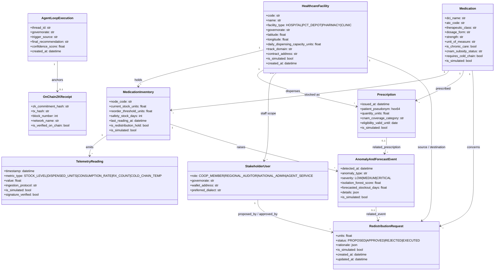

# UML Class Diagram — Track 5 · Tunihara-MedGuard (Week 1)

Mermaid source (renders on GitHub / VS Code "Markdown Preview Mermaid Support"; export to PNG/SVG with
`npx @mermaid-js/mermaid-cli -i docs/uml/class_diagram.md -o docs/uml/class_diagram.svg` for the slides).
Class names, attributes and relationships mirror `backend/tunisovereign_core/models.py`; the test
`tests/test_uml_consistency.py` fails if they drift.

Starter → Track 5 mapping: `CooperativeUnit → HealthcareFacility`, `ResourceNodePlot → MedicationInventory`;
`Medication`, `Prescription`, `RedistributionRequest` are new; the other models keep their starter names.
All data is **synthetic** (`is_simulated`); patients exist only as irreversible pseudonyms.

## Notes

* **Isolation rule** (enforced in `scope.py` for REST, GraphQL and gRPC): `COOP_MEMBER` → own facility;
  `REGIONAL_AUDITOR` → own governorate; `NATIONAL_ADMIN` / `AGENT_SERVICE` → everything.
* `TelemetryReading` is unique on `(inventory, metric_type, timestamp)` → ingestion is idempotent.
* `MedicationInventory.current_stock_units` / `last_reading_at` are derived from validated telemetry,
  never client-writable. Consumption is derived from `DISPENSED_UNITS` telemetry (no separate table in Week 1).
* `AgentLoopExecution` and `OnChainZKReceipt` exist as schema only; Week 3 populates them.
