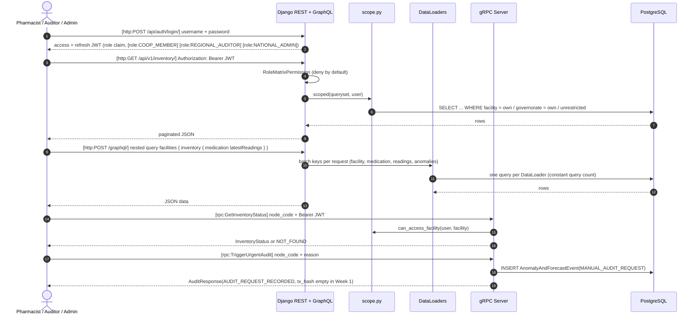

# UML Sequence Diagram — Track 5 · Tunihara-MedGuard (Week 1)

Two workflows that exist in the code today. Bracketed markers `[rpc:…]`, `[http:…]` and `[role:…]` are
machine-checked by `tests/test_uml_consistency.py` against `protos/tunisovereign.proto`, the URLconf and the role enum.

## 1. Telemetry ingestion (simulator → gRPC → PostgreSQL)

```mermaid
sequenceDiagram
  autonumber
  participant Sim as Telemetry Simulator<br/>simulator/tunisian_simulator.py
  participant API as Django REST<br/>config/urls.py
  participant G as gRPC Server<br/>grpc_service/server.py
  participant ING as Ingestion service<br/>telemetry_ingest.py
  participant DB as PostgreSQL

  Sim->>API: [http:POST /api/auth/login/] AGENT_SERVICE credentials
  API-->>Sim: JWT access token (claims: role, governorate, facility_id)
  loop every simulated hour x every medication position
    Sim->>Sim: build packet + HMAC-SHA256 over node|governorate|metric|value|timestamp
  end
  Sim->>G: [rpc:StreamTelemetry] stream TelemetryPacket + metadata authorization: Bearer JWT
  G->>G: verify JWT signature/expiry, user active, [role:AGENT_SERVICE]
  alt token missing / invalid / wrong role
    G-->>Sim: UNAUTHENTICATED / PERMISSION_DENIED
  else authorised
    loop chunks of 500 packets
      G->>ING: ingest_packets(chunk)
      ING->>ING: validate format, metric, range, timestamp; verify HMAC (constant-time)
      ING->>DB: SELECT inventories by node_code; SELECT existing readings
      ING->>DB: INSERT readings (bulk, ON CONFLICT DO NOTHING) + UPDATE inventory snapshot
      DB-->>ING: ok
    end
    G-->>Sim: IngestAck(accepted, duplicates, rejected, reasons)
  end
```

## 2. Authenticated read path with isolation (REST + GraphQL + gRPC unary)



Week 2/3 hooks (not implemented): anomaly scoring after ingestion, the LangGraph agent behind
`TriggerUrgentAudit`, and on-chain anchoring that fills `OnChainZKReceipt.tx_hash`.
